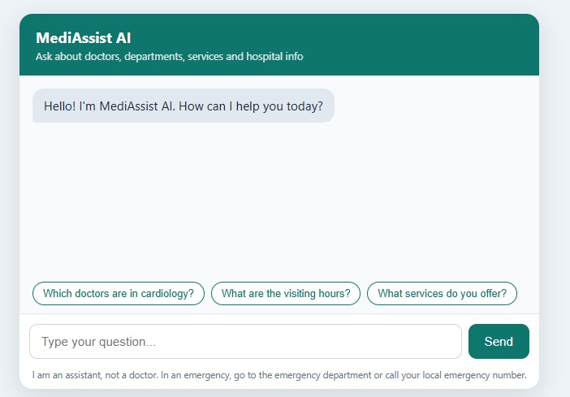
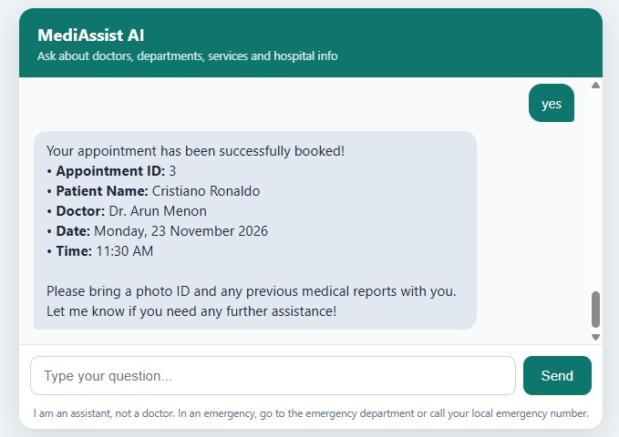

# MediAssist AI

A hospital assistant chatbot. Patients can ask about doctors, departments, services and FAQs, and book appointments in a chat. Answers come from a PostgreSQL database, and the replies are written by Google Gemini.

> This project uses made-up sample data (doctors, prices, timings). It is a learning project and is not a substitute for medical advice.

## Screenshots

**Chat**



**Appointment booking**



**Appointments stored in PostgreSQL**


## Features

- Answers questions about doctors, departments, services and FAQs using real data from the database
- Replies only from the hospital data and does not invent information
- Does not diagnose or suggest medicines, and sends emergencies to the emergency department
- Remembers earlier messages within the same chat session
- Books appointments through a Gemini tool, with checks for:
  - the doctor's available days and time
  - past dates and dates too far ahead
  - valid phone number and time format
  - double booking of the same slot (enforced by a database index)
- Saves every conversation in a `chat_history` table
- Falls back to other Gemini models if one is busy or out of quota
- Simple chat page built with HTML, CSS and JavaScript

## Tech stack

- **Backend:** Python, FastAPI
- **Database:** PostgreSQL 17 (Docker)
- **AI:** Google Gemini API (`google-genai` SDK)
- **Frontend:** HTML, CSS, JavaScript
- **Automation (in progress):** n8n

## How it works

1. The patient sends a message from the chat page to `POST /chat`.
2. The backend loads the hospital data (departments, doctors, services, FAQs) and the recent messages of that session.
3. Gemini writes the reply using that data and a set of safety rules.
4. For a booking, Gemini collects the details, asks the patient to confirm, then calls the `book_appointment` function. The function validates everything and saves the appointment, so Gemini cannot book an invalid slot.
5. The messages are saved in `chat_history`.

## Database tables

| Table | Purpose |
|---|---|
| `departments` | Hospital departments |
| `doctors` | Doctors, linked to a department, with available days and time |
| `services` | Services and prices |
| `faqs` | Common questions and answers |
| `appointments` | Bookings, linked to a doctor |
| `chat_history` | Messages grouped by session |

## Project structure

```
Medical_Health_Assistant/
├── app.py                  # FastAPI app (chat API and chat page)
├── docker-compose.yml      # PostgreSQL (and n8n)
├── requirements.txt
├── .env.example            # Template for your settings
├── static/
│   └── index.html          # Chat page
├── services/
│   └── chatbot.py          # Gemini logic, safety prompt, model fallback
├── database/
│   ├── queries.py          # Read queries
│   ├── history.py          # Save and load chat history
│   ├── booking.py          # Appointment booking with validation
│   ├── create_tables.py
│   ├── create_more_tables.py
│   ├── insert_sample_data.py
│   ├── insert_services_faqs.py
│   ├── test_connection.py
│   └── test_queries.py
├── workflows/              # Exported n8n workflows
└── assets/                 # Screenshots
```

## Setup

**Requirements:** Python 3.10 or newer, Docker Desktop, and a Gemini API key from Google AI Studio.

1. Clone the repo and create a virtual environment:
   ```
   git clone https://github.com/Shobhish/mediassist-ai.git
   cd mediassist-ai
   python -m venv venv
   venv\Scripts\activate
   ```
2. Install the dependencies:
   ```
   python -m pip install -r requirements.txt
   ```
3. Create your settings file. Copy `.env.example` to `.env` and fill in your values:
   ```
   GEMINI_API_KEY=your_gemini_api_key_here
   GEMINI_MODEL=gemini-3.6-flash

   DB_HOST=localhost
   DB_PORT=5432
   DB_NAME=mediassist_db
   DB_USER=mediassist_user
   DB_PASSWORD=your_password_here
   ```
4. Start PostgreSQL:
   ```
   docker compose up -d postgres
   ```
5. Create the tables and add the sample data:
   ```
   python database/create_tables.py
   python database/create_more_tables.py
   python database/insert_sample_data.py
   python database/insert_services_faqs.py
   ```
6. Start the app:
   ```
   python -m uvicorn app:app --reload
   ```
7. Open http://127.0.0.1:8000 and start chatting.

To try the chatbot in the terminal instead, run `python -m services.chatbot`.

## Try these in the chat

- `Which doctors are in cardiology?`
- `What are the visiting hours?`
- `I want to book an appointment with Dr. Arun Menon`
- `I have chest pain` (it should point to the emergency department)

## Notes

- Keep `.env` private. It is listed in `.gitignore` and must never be committed.
- The Gemini free tier has daily request limits per model. If one model runs out, the app tries the next one in the list in `services/chatbot.py`.
- Appointments and chat history store names and phone numbers. Use fake data while testing.

## Roadmap

- [x] PostgreSQL database and sample data
- [x] Gemini chatbot with safety rules
- [x] Chat history and conversation memory
- [x] Chat page (HTML/CSS/JS)
- [x] Appointment booking
- [ ] n8n automation (booking notifications)
- [ ] Admin dashboard
- [ ] Deployment

## Author

Shobhish Balakrishnan, [GitHub](https://github.com/Shobhish)