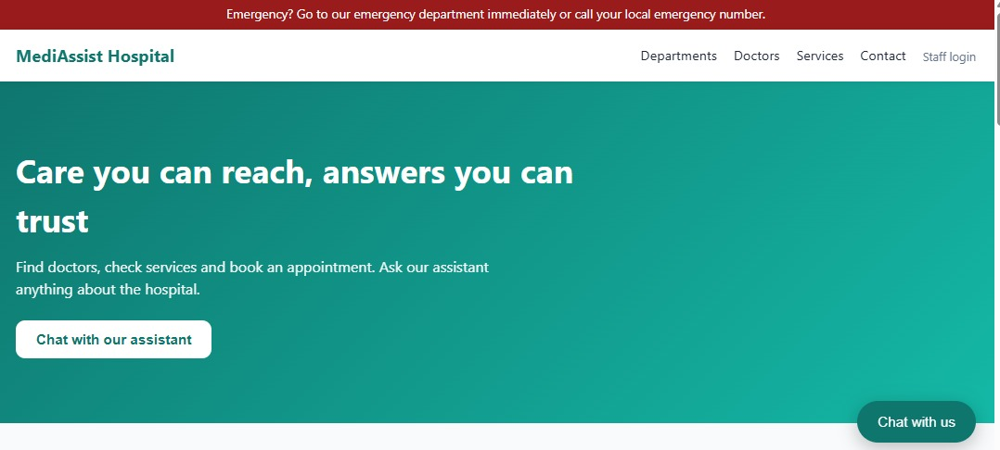
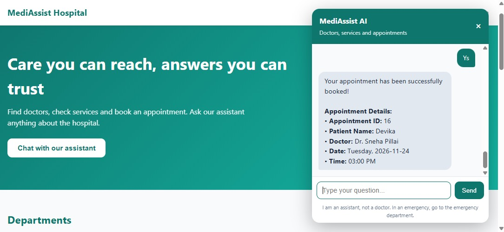
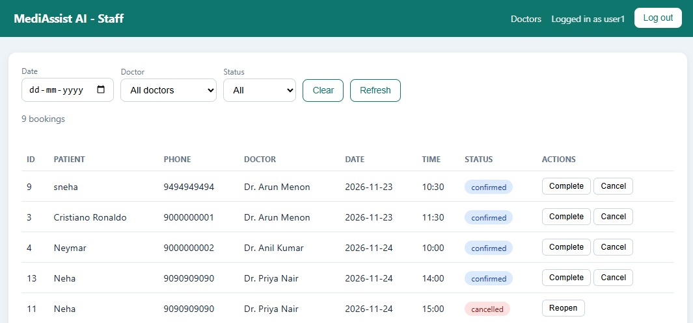
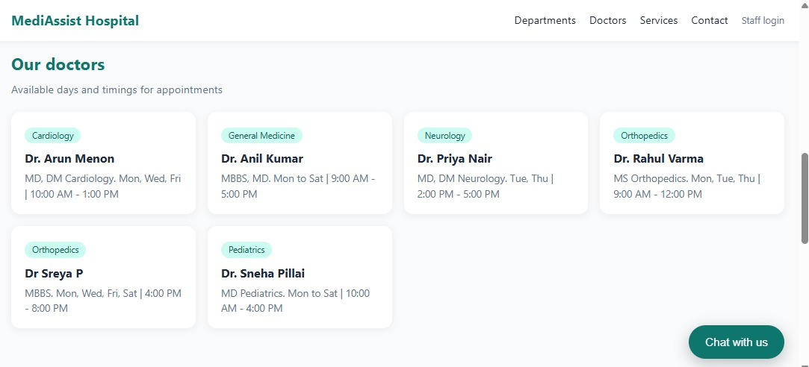
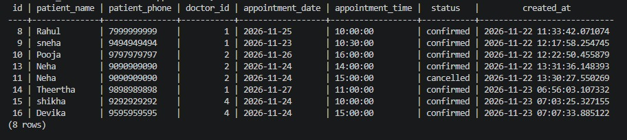

# MediAssist AI

A hospital website with an AI assistant. Patients can browse doctors, departments and services, ask questions in a chat, and book appointments. Hospital staff log in to see bookings and manage doctors and services. Answers come from a PostgreSQL database, and the replies are written by Google Gemini.

**Live demo:** https://medical-assistant-ai-h9y8.onrender.com

> The demo runs on free hosting, so the first load can take up to a minute while it wakes up. It uses made-up data only. Please don't enter real personal information.

> This is a learning project with made-up sample data (doctors, prices, timings). It is not a real hospital and not a substitute for medical advice.

## Screenshots

**Home page**



**Chat assistant booking an appointment**



**Staff dashboard (bookings)**



**Staff: manage doctors**



**Appointments stored in PostgreSQL**



## Features

**For patients**
- Hospital home page showing departments, doctors and services, loaded live from the database
- Chat assistant that answers only from hospital data, does not diagnose, and sends emergencies to the emergency department
- Remembers earlier messages within the same chat session
- Books appointments through a Gemini tool, with checks for:
  - the doctor's available days and time
  - past dates and dates too far ahead
  - a valid phone number and time format
  - double booking of the same slot (enforced by a database index)

**For staff**
- Staff login with hashed passwords (bcrypt) and a signed session cookie
- Bookings dashboard with filters by date, doctor and status, and buttons to complete, cancel or reopen a booking
- Admin pages to add, edit and delete doctors and services
- Changes made by staff appear in the chatbot and on the home page straight away
- Doctor schedules are format-checked, so a wrong entry can never break booking

**Other**
- Falls back to other Gemini models if one is busy or out of quota
- Every conversation is saved in a `chat_history` table
- New bookings are sent to an n8n webhook (optional, runs locally)

## Tech stack

- **Backend:** Python, FastAPI
- **Database:** PostgreSQL 17 (Docker locally, Neon in production)
- **AI:** Google Gemini API (`google-genai` SDK)
- **Frontend:** HTML, CSS, JavaScript
- **Security:** bcrypt, signed session cookies, parameterised SQL
- **Automation:** n8n (Docker, optional)
- **Hosting:** Render (web service) and Neon (serverless PostgreSQL)

## How it works

1. A patient opens the home page and uses the chat widget, which calls `POST /chat`.
2. The backend loads the hospital data (departments, doctors, services, FAQs) and the recent messages of that session.
3. Gemini writes the reply using that data and a set of safety rules.
4. For a booking, Gemini collects the details, asks the patient to confirm, then calls the `book_appointment` function. The function validates everything and saves the appointment, so Gemini cannot book an invalid slot.
5. The backend saves the messages in `chat_history` and sends the new booking to n8n, if configured.
6. Staff log in, see the booking on the dashboard, and manage doctors and services.

Gemini only receives public hospital data. Appointments and patient details are never sent to it.

## Database tables

| Table | Purpose |
|---|---|
| `departments` | Hospital departments |
| `doctors` | Doctors, linked to a department, with available days and time |
| `services` | Services and prices |
| `faqs` | Common questions and answers used by the chatbot |
| `appointments` | Bookings, linked to a doctor |
| `chat_history` | Messages grouped by session |
| `staff_users` | Staff accounts with hashed passwords and a role |

## Project structure

```
Medical_Health_Assistant/
├── app.py                  # FastAPI app: chat, staff login, bookings, doctors
├── routes_services.py      # Staff: manage services
├── routes_public.py        # Public data for the home page
├── docker-compose.yml      # PostgreSQL and n8n for local use
├── requirements.txt
├── .env.example            # Template for your settings
├── static/
│   ├── index.html          # Home page with chat widget
│   ├── staff_login.html
│   ├── staff_dashboard.html
│   ├── staff_doctors.html
│   └── staff_services.html
├── services/
│   └── chatbot.py          # Gemini logic, safety prompt, model fallback
├── database/
│   ├── queries.py          # Read queries
│   ├── history.py          # Save and load chat history
│   ├── booking.py          # Appointment booking with validation
│   ├── staff_auth.py       # Staff login check
│   ├── staff_queries.py    # Bookings and doctors for staff
│   ├── services_queries.py # Services for staff
│   ├── create_tables.py
│   ├── create_more_tables.py
│   ├── create_staff_table.py
│   ├── create_admin.py
│   ├── insert_sample_data.py
│   └── insert_services_faqs.py
├── workflows/              # Exported n8n workflows
└── assets/                 # Screenshots
```

## Setup (local)

**Requirements:** Python 3.10 or newer, Docker Desktop, and a Gemini API key from Google AI Studio.

1. Clone the repo and create a virtual environment:
   ```
   git clone https://github.com/Shobhish/Medical_Assistant_AI.git
   cd Medical_Assistant_AI
   python -m venv venv
   venv\Scripts\activate
   ```
2. Install the dependencies:
   ```
   python -m pip install -r requirements.txt
   ```
3. Copy `.env.example` to `.env` and fill in your values. Create the session secret with:
   ```
   python -c "import secrets; print(secrets.token_hex(32))"
   ```
4. Start PostgreSQL:
   ```
   docker compose up -d postgres
   ```
5. Create the tables and add the sample data:
   ```
   python database/create_tables.py
   python database/create_more_tables.py
   python database/create_staff_table.py
   python database/insert_sample_data.py
   python database/insert_services_faqs.py
   ```
6. Create the first admin account (you choose the username and password at the prompt):
   ```
   python -m database.create_admin
   ```
7. Start the app:
   ```
   python -m uvicorn app:app --reload
   ```
8. Open http://127.0.0.1:8000 for the website. Staff log in at http://127.0.0.1:8000/staff/login.

To try the chatbot in the terminal instead, run `python -m services.chatbot`.

**Optional: n8n.** Run `docker compose up -d n8n`, open http://localhost:5678, create a workflow with a Webhook node (POST, path `new-booking`), and publish it. New bookings are then posted to it automatically.

## Deployment

The live demo runs on Render (free web service) with a Neon PostgreSQL database.

- **Build command:** `pip install -r requirements.txt`
- **Start command:** `uvicorn app:app --host 0.0.0.0 --port $PORT --proxy-headers --forwarded-allow-ips="*"`
- **Environment variables** (set on the host, never committed): `GEMINI_API_KEY`, `GEMINI_MODEL`, `DB_HOST`, `DB_PORT`, `DB_NAME`, `DB_USER`, `DB_PASSWORD`, `PGSSLMODE=require`, `SESSION_SECRET`, `HTTPS_ONLY=true`, `PYTHON_VERSION`

The n8n workflow is optional and only runs locally. If `N8N_WEBHOOK_URL` is not set, the app skips it.

## Try these in the chat

- `Which doctors are in cardiology?`
- `What are the visiting hours?`
- `I want to book an appointment with Dr. Arun Menon`
- `I have chest pain` (it should point to the emergency department)

## Security

- Staff passwords are hashed with bcrypt, and sessions use a signed, HTTPS-only cookie
- Login attempts are limited (5 failures in 5 minutes), and chat messages are limited per visitor
- Staff API routes check the login on the server, and admin-only routes check the role
- All SQL uses parameters, which prevents SQL injection
- Text from the database or from patients is shown with `textContent`, which prevents script injection
- Gemini only receives public hospital data. Appointments and patient details are never sent to it
- The booking tool validates every detail itself, so the AI cannot book an invalid slot

## Limitations

- Free hosting sleeps when idle, so the first request is slow
- The free Gemini quota is shared by all visitors, and the app falls back to other models when one runs out
- Staff accounts are created by script, and there is no password reset yet
- Chat messages are sent to the Gemini API, so real patient information should not be entered
- This is a demo. A real hospital system would also need audit logs, consent handling and a security review

## Notes

- Keep `.env` private. It is listed in `.gitignore` and must never be committed.
- Appointments and chat history store names and phone numbers. Use fake data while testing.

## Roadmap

- [x] PostgreSQL database and sample data
- [x] Gemini chatbot with safety rules
- [x] Chat history and conversation memory
- [x] Appointment booking with validation
- [x] Hospital home page with chat widget
- [x] Staff login and bookings dashboard
- [x] Admin pages for doctors and services
- [x] n8n booking webhook (local, optional)
- [x] Deployment (Render and Neon)
- [ ] Staff notifications (Telegram or email)
- [ ] Read-only staff role and password reset

## Author

Shobhish Balakrishnan, [GitHub](https://github.com/Shobhish)